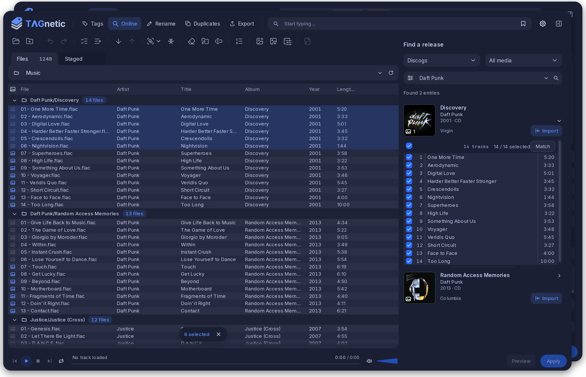
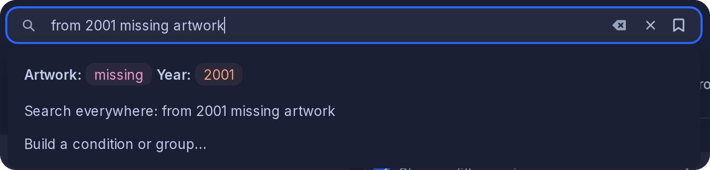
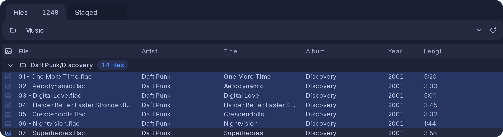
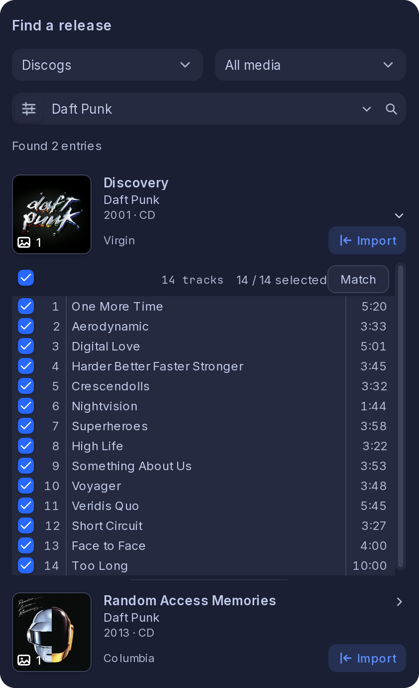
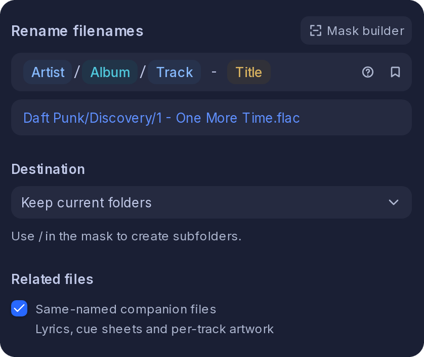
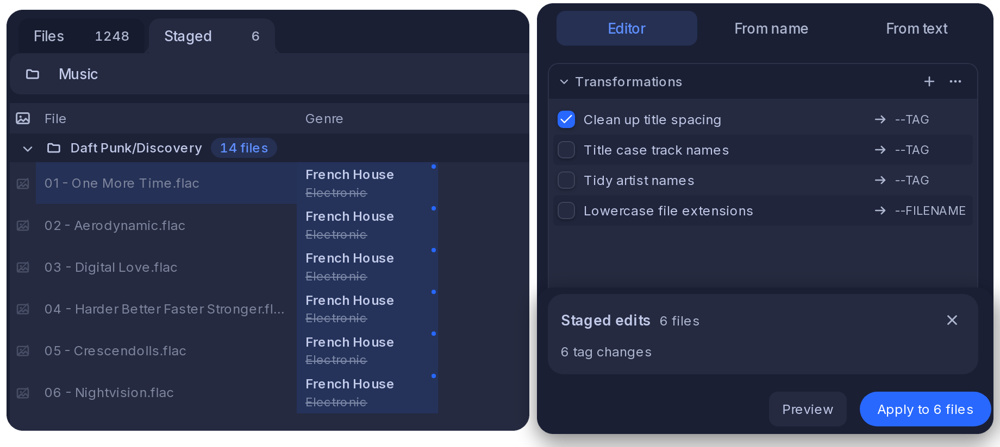
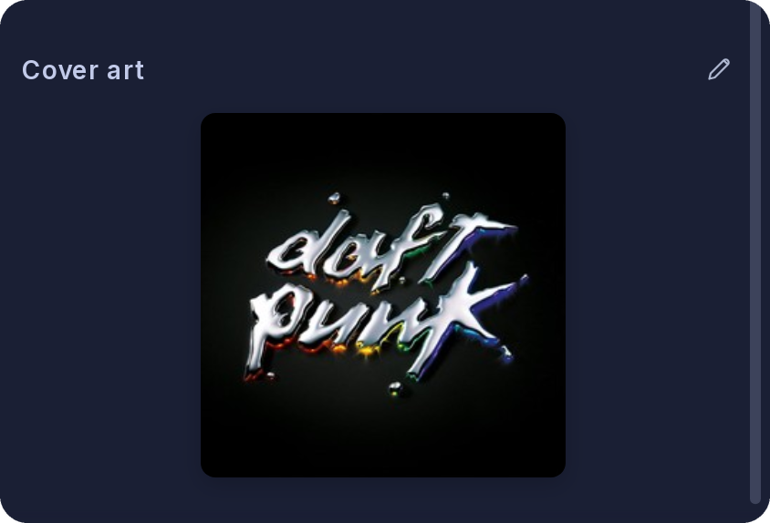

<p align="center">
  
</p>

<h1 align="center">Tagnetic</h1>

<p align="center">
  <strong>Get your music library in order.</strong><br>
  Fix tags, find the right artwork and turn messy filenames into a collection you can browse.<br>
  See exactly what will change before you save.
</p>

<p align="center">
  <strong><a href="https://github.com/djhappyman/TAGnetic/releases/latest">Download Tagnetic</a></strong><br>
  Free and open source for Windows, macOS and Linux
</p>

<p align="center">
  
</p>

## Find the tracks you meant to find

Type `from 2001 missing artwork` and Tagnetic suggests filters you can see and adjust. Narrow the results by artist, genre or BPM, then save the search if you’ll need it again. Each filter appears as a chip, so you can see why a track is in the list.

<p align="center">
  
</p>

## Give an album its proper tags

Select the tracks you want to fix. Look up the release on Discogs, MusicBrainz or another supported catalogue and check the tracklist against your files. Bring in just the fields you need. Fill in titles or add a cover while keeping the artist tags you’ve already cleaned up.

<p align="center">
  
</p>

<p align="center">
  
</p>

## Turn messy filenames into something you can browse

Build a naming pattern with coloured field chips for **Artist**, **Album** and **Track**. See the resulting filenames and folders before anything moves. The same chips help you build tag values from existing fields. Save a pattern once and use it on the next batch.

<p align="center">
  
</p>

## See what you’re about to save

Save transformations for jobs you do often, like tidying title spacing or normalising file extensions. Open **Staged** to compare the old and new values, then apply the whole batch or leave individual files out. If you spot something later, you can undo an applied batch even after restarting Tagnetic.

<p align="center">
  
</p>

## Keep the copy you want

Got several versions of the same track? Find exact copies, matching audio or likely duplicates, then compare their tags, artwork, format and duration. The scan leaves your files alone while you decide which copy belongs in your collection.

## Work through your library without losing your place

Expand albums in place, step through tags with the keyboard and check the track you’re working on with the built-in player. The table and sidebar stay together as you move from selecting tracks to editing and reviewing them. Tagnetic is a native desktop app with a Rust backend that reads and validates tags, applies changes and keeps the Undo history.

<p align="center">
  
</p>

## Let an agent help with the batch

Pair **Codex** or **OpenCode** through **Settings → MCP connection**. Ask it to find missing artwork or stage a cleanup in the folder you’ve shared. Its proposed changes appear in the same **Staged** view you use by hand, where you can review them, adjust them and apply the batch yourself. [Set up MCP](docs/mcp/README.md)

## Download Tagnetic

**[Get the latest release](https://github.com/djhappyman/TAGnetic/releases/latest)**

| Platform | What to download |
| --- | --- |
| Windows x64 or ARM64 | `.exe` installer |
| macOS Apple Silicon or Intel | Universal `.dmg` |
| Linux x64 | `.deb`, `.rpm` or AppImage |
| Linux ARM64 | `.deb` or `.rpm` |

[User guide](docs/guide/README.md) · [Supported features and formats](docs/FEATURES.md) · [What’s new](CHANGELOG.md)

## Where it started

Tagnetic started with the open-source **TagRex** codebase. **TagScanner for Windows** is its biggest inspiration, alongside ideas from favourite tag editors across platforms. Tagnetic builds on that foundation with its own workbench, readable search filters, field chips and shared editing with agents. [TagRex](https://github.com/tagrex/tagrex) · [TagScanner](https://xdlab.ru/)

## Contribute

Have a workflow you’d like to improve? [Open an issue](https://github.com/djhappyman/TAGnetic/issues) and tell us what you were trying to do. For code contributions, build the app locally and open a focused pull request against this repository’s `main` branch. [Build guide](docs/BUILDING.md) · [Contribution workflow](docs/WORKFLOW.md)

<details>
<summary>Run from source</summary>

Install Node 22.12 or newer, Rust and the [Tauri prerequisites](https://v2.tauri.app/start/prerequisites/) for your platform. From the cloned repository, run:

```sh
npm ci
npm run desktop:dev
```

</details>

Tagnetic is licensed under [GPL-3.0-only](LICENSE).

<sub>Demo screenshots use silent, disposable files with real release metadata. [Screenshot credits](docs/img/product-tour/SOURCES.md)</sub>
