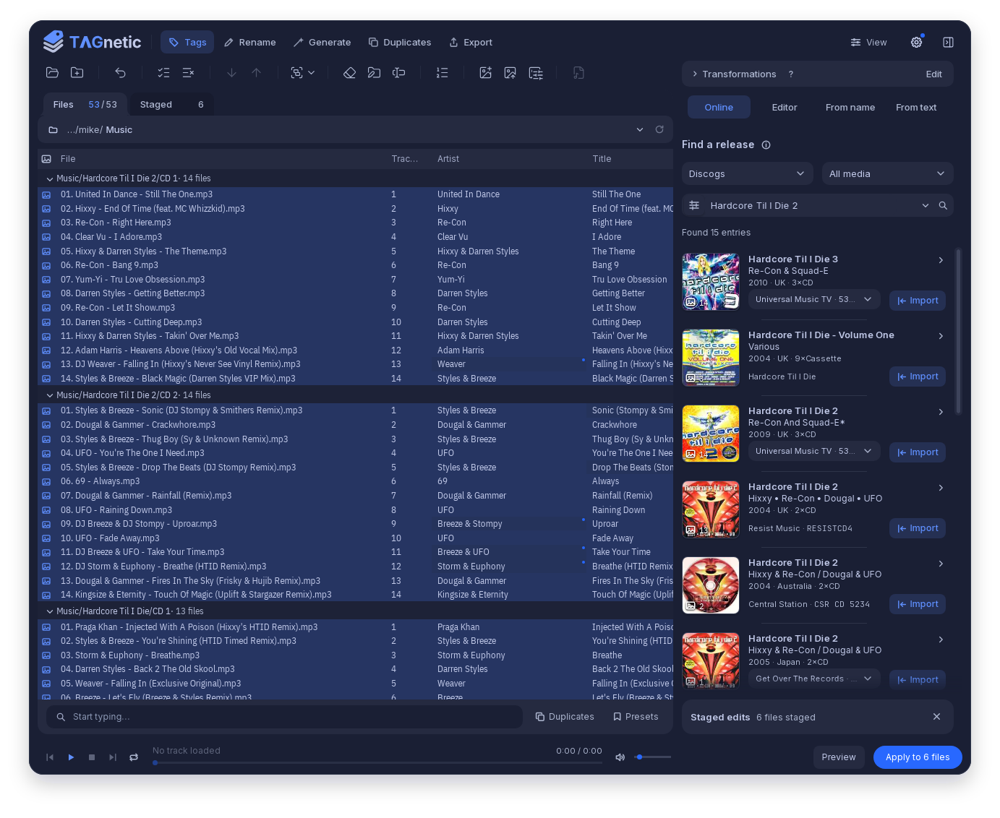
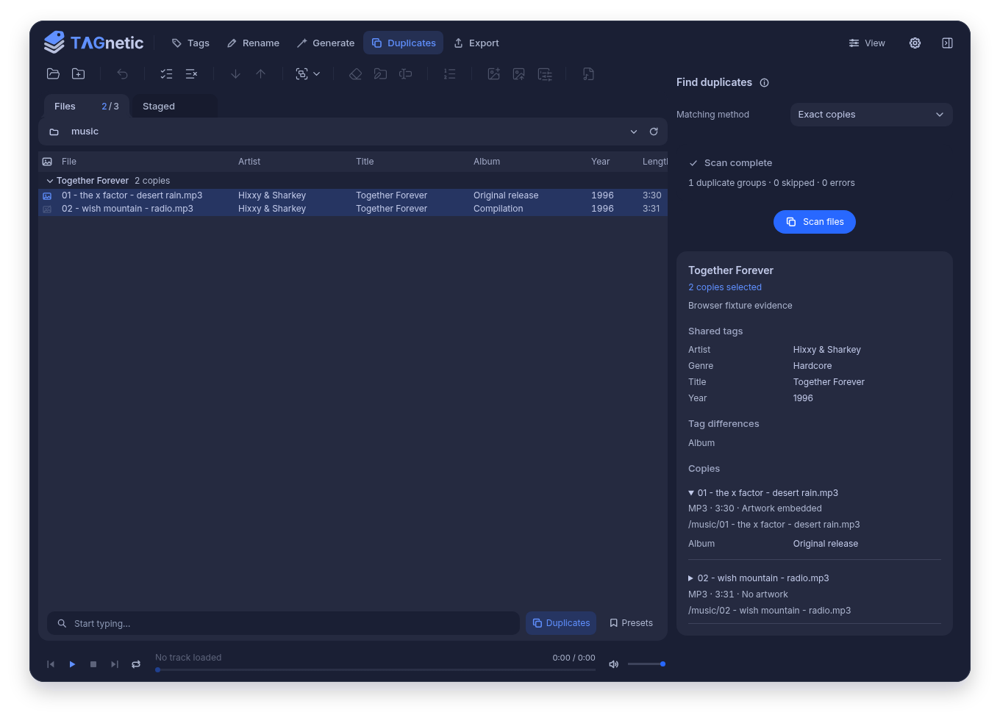

<p align="center">
  
</p>

<h1 align="center">Tagnetic</h1>

<p align="center">
  <b>A free music tag editor for Windows, macOS and Linux.</b><br>
  Edit tags, organise files, find artwork and spot duplicates.<br>
  Preview your changes, save when ready and undo an applied batch later.
</p>

<p align="center">
  <a href="https://github.com/djhappyman/TAGnetic/releases">Download</a> ·
  <a href="docs/guide/README.md">User guide</a> ·
  <a href="CHANGELOG.md">What’s new</a> ·
  <a href="https://github.com/djhappyman/TAGnetic/issues">Report an issue</a>
</p>

<p align="center">
  
</p>

## What it can do

| Feature | What you can do |
| --- | --- |
| **Edit music tags** | Edit tracks in a table or update a whole selection. Copy, paste, number tracks and choose the columns you need. |
| **Search with chips** | Type a name or genre, choose a suggested filter and keep narrowing the results. Combine conditions and save presets to use again. |
| **Find artists across collaborations** | Find Hixxy on his own or in credits such as Hixxy & Sharkey and Hixxy feat. another artist. Searches ignore letter case. |
| **Find duplicates** | Check for exact file copies, matching audio or likely copies of the same recording. Compare tags and file details without changing your files. |
| **Look up releases** | Find tags and artwork on Discogs, MusicBrainz, Beatport, Bandcamp and Soundeo. You can also read tags from file names or pasted tracklists. |
| **Organise files** | Rename tracks and build folders from their tags. Preview the resulting names and locations before applying them. |
| **Clean up tags** | Fix spacing, change case, replace text and reuse your own transformation presets. |
| **Manage artwork** | Browse, import, rotate, embed and export cover images. |
| **Check BPM and keys** | Detect tempo from the audio and convert between musical and Camelot key notation. |
| **Preview and undo** | Review before-and-after values in Staged. Applied batches stay available for Undo, even after restarting the app. |
| **Work with an agent** | Connect Codex or another [MCP client](docs/mcp/README.md). Watch edits appear in your shared stage and keep editing alongside it. |
| **Export and listen** | Create playlists and reports, or check a track with the built-in player and waveform. |
| **Make it yours** | Choose light or dark themes, collapse the sidebar, arrange columns and customise keyboard shortcuts. |

Supports MP3, FLAC, M4A/MP4, AAC, WAV, AIFF, Ogg Vorbis, Opus, Speex, Musepack, Monkey’s Audio and WavPack.

## Find and compare duplicates

Choose a matching method and scan the open files. Results appear in groups as they are found. Select a group to compare every copy, including its tags, path, format, duration and artwork.

Duplicate scanning is read-only. It does not delete or merge your music.

<p align="center">
  
  <br>
  <sub>Duplicate review with an example library.</sub>
</p>

## A simple workflow

1. **Open a folder.** Browse the files or narrow them with search chips.
2. **Stage your changes.** Edit tags, import a release, change artwork or rename files.
3. **Review and Apply.** Check the before-and-after values in Staged, then save. Undo an applied batch if you need to.

## Features and roadmap

Our long-term goal is feature parity with [Mp3tag](https://www.mp3tag.de/en/), while keeping Tagnetic’s own workflow: stage changes, review them, Apply and Undo. New capabilities will build on the existing tools and shared staging area.

- **Feature checkboxes** are ticked only when the backend and UI are implemented and verified together, within the scope described.
- **Backend checkboxes** track completed Rust capabilities and their tests. Backend completion alone leaves the feature unticked.
- **UI checkboxes** track the controls and interactions needed to use the capability in the app.
- **Unchecked features without a breakdown** remain planned. Add backend and UI progress underneath as implementation begins.

New metadata capabilities use current staged values, field locks, the shared change plans and the existing Apply/Undo system. They must preserve unrelated pending edits and selection. Exports use the existing guarded output flow. Features should extend these systems and the current workflow.

The backend foundation checkpoint `2a9341e9` is committed on `feat/native-field-foundations`. The next Rust batch checkpoint is documented in [native batch operations](docs/guide/native-batch-operations.md), with [verification evidence](docs/performance/native-batch-operations.md). Completed parts are recorded below; this does not mark them as merged into `main` or installed in the running app.

A completed basic feature does not mean every advanced option is finished. The list tracks product capabilities, not delivery dates or a guarantee for every file variant. See the [changelog](CHANGELOG.md) for release history and the [engineering roadmap](docs/ROADMAP.md) for performance, platform testing and release work.

### Editing and reviewing changes

- [x] **Table editing.** Edit tag values directly in the file table.
- [x] **Bulk editing.** Change a field across selected tracks in one operation.
- [x] **Mixed-value editing.** Keep each track’s existing value unless you choose to change it.
- [x] **Live shared edits.** See pending changes reflected in Files, Staged and the Inspector while you work.
- [x] **Before-and-after review.** Compare saved values with proposed values before applying them.
- [x] **Focused Staged view.** Review only files and tag columns with actual changes.
- [x] **Selective Apply.** Choose which changed files to include in a saved batch.
- [x] **Discard changes.** Remove unwanted proposals without writing them to the music files.
- [x] **Field locks.** Protect chosen fields from operations that would otherwise change them.
- [x] **Spreadsheet copy and paste.** Copy and paste rectangular ranges of tag values.
- [x] **Fill down.** Repeat a cell value across a selected range.
- [x] **Multiple artists and genres.** Read and write separate values in supported artist, album-artist, genre and composer fields.
- [x] **Custom text fields.** Add extra information beyond the standard tag fields.
- [x] **Format values.** Fill common destination fields using a pattern made from other tags and text.
- [x] **Clear individual fields.** Remove selected tag values while keeping other information.
- [x] **Clear text tags.** Start fresh with text metadata while retaining artwork and cue data.
- [ ] **Custom fields in every tool.** Use your own fields in naming patterns, imports, formulas and saved recipes.
  - [x] **Backend foundation.** Resolve custom fields and use explicit custom-field patterns in the shared Rust pattern engine.
  - [ ] **UI completion.** Make custom-field selection and references available throughout the relevant tools and verify the complete workflows.
- [ ] **Custom field mappings.** Give equivalent fields a consistent name across different file formats.
- [ ] **Whole-tag copy and paste.** Transfer a complete set of supported metadata between files.
- [ ] **Formatted clipboard output.** Copy selected tracks as a ready-to-paste tracklist or another chosen layout.

### Transformations and reusable recipes

- [x] **Saved transformation presets.** Keep named cleanup rules and reuse them on another selection.
- [x] **Ordered transformation chains.** Run enabled rules in sequence, with each building on the previous result.
- [x] **Preset editor.** Create, copy, rename and reorder personal presets, and copy built-ins to adapt them.
- [x] **Transformation samples.** Check a before-and-after example while editing a preset.
- [x] **Field-specific rules.** Aim a rule at all text tags, a particular field, filenames or extensions.
- [x] **Find and replace.** Replace text with case-sensitive and whole-word options.
- [x] **Regular-expression replacement.** Clean up text using patterns rather than only exact words.
- [x] **Case conversion.** Change text to title case, sentence case, lowercase or uppercase.
- [x] **Title-case exceptions.** Preserve known acronyms and optionally keep selected small words lowercase.
- [x] **Spacing cleanup.** Trim unwanted spaces and collapse repeated whitespace with cleanup presets.
- [x] **Discogs name cleanup.** Remove artist disambiguation numbers and name-variation markers with a preset.
- [x] **Accent removal.** Turn accented Latin letters into their unaccented equivalents.
- [x] **Transliteration.** Convert supported Cyrillic and Greek text into Latin letters, with a separate Cyrillic conversion rule.
- [x] **Key notation conversion.** Convert recognised keys between musical, Camelot and Open Key notation.
- [x] **Pattern functions.** Build names and values with nested text functions, conditions and arithmetic.
- [ ] **Cross-field recipe steps.** Save field-copying and field-combining operations inside reusable recipes.
  - [x] **Backend.** Run and save native field assignments over current staged values, with ordered steps, field locks and MCP support.
  - [ ] **UI completion.** Add field-copying and field-combining steps to the recipe editor, including custom destinations.
- [ ] **Split combined information.** Extract separate artist, title or other fields from a combined value.
  - [x] **Backend.** Extract several fields from a staged value or expression, with unmatched-file reporting and the existing locks and Undo.
  - [ ] **UI completion.** Add source and extraction-pattern controls to the recipe editor.
- [ ] **Selective removal recipes.** Save a list of fields to remove during cleanup.
  - [x] **Backend.** Remove named text fields through the existing plan and Undo system, with explicit artwork-removal targets.
  - [ ] **UI completion.** Add field-removal steps and clear field selection to the recipe editor.
- [ ] **Keep-only recipes.** Retain an approved set of fields and remove unwanted extras.
  - [x] **Backend.** Keep an approved set of text fields while respecting field locks and preserving artwork by default.
  - [ ] **UI completion.** Add keep-only steps to the recipe editor and show the fields being retained and removed.
- [ ] **General multiple-value editing.** Manage separate values in more supported fields without flattening their meaning.
  - [x] **Backend foundation.** Represent ordered values without losing literal punctuation, and refuse conversions the existing storage cannot preserve.
  - [ ] **Backend expansion.** Carry arbitrary repeated fields through container reads, writes, shared staging and journaled Undo without joining them into strings.
  - [ ] **UI completion.** Add a value-list editor and make supported repeated values available across the tools.
  - [x] **Backend foundation.** Keep ordered values in a bounded Rust type and refuse conversions that would lose their meaning.
  - [ ] **Backend expansion.** Preserve arbitrary repeated fields through format adapters, staging, storage, journal recovery and Undo.
  - [ ] **UI completion.** Show and edit individual values without relying on a joined table string.
- [ ] **Split values.** Turn a written list of artists or genres into separate values.
  - [x] **Backend.** Split Artist, Album Artist, Genre and Composer with an explicit separator, trimming spacing and leaving other fields alone.
  - [ ] **UI completion.** Add split-value controls and show the resulting separate values.
- [ ] **Merge values.** Join separate values into one value using your chosen separator.
  - [x] **Backend.** Join supported artist, album-artist, genre and composer values; reject a separator that would turn the result back into several values.
  - [ ] **UI completion.** Add a join separator and preview of the resulting single value.
- [ ] **Deduplicate values.** Remove repeated artists, genres or other values within a file.
  - [x] **Backend.** Remove exact repeated values from the four supported list fields while retaining the first occurrence and original order.
  - [ ] **UI completion.** Add deduplication to the recipe editor and show which values will remain.
- [ ] **Advanced pattern functions.** Add individual-value access, field enumeration and more text, date and path helpers.
- [ ] **Complete workflow recipes.** Combine tag edits, artwork operations, naming and output generation with clear review and save boundaries.
- [ ] **Encoding repair in recipes.** Include existing legacy-text repair operations in a repeatable cleanup job.
- [ ] **Folder and field-name transformations.** Extend supported rules to directory names and supported stored field names.

### Finding and organising files

- [x] **Folder browsing.** Open a folder and read supported music files from its subfolders.
- [x] **Multiple-file and folder drops.** Work with loose files, several folders or a mixture of both.
- [x] **Recent folders.** Return to folders you have opened before.
- [x] **Remove from the list.** Set files aside in the current session without deleting them.
- [x] **Move to Trash.** Send selected files to the operating system’s Trash with confirmation.
- [x] **Refresh from disk.** Re-read files after changes made outside the app.
- [x] **Natural filename sorting.** Keep numbered names in a sensible order, such as 2, 9, 10.
- [x] **Folder-aware sorting.** Sort tracks inside folders while retaining the folder sequence.
- [x] **Manual file ordering.** Arrange tracks in the order needed for imports and numbering.
- [x] **Grouped browsing.** Group files by folder, artist, album and other available fields.
- [x] **Group selection.** Select a whole group or combine groups and individual tracks.
- [x] **Search suggestions.** Choose relevant artists, genres and other values from the open collection.
- [x] **Search chips.** Build readable filters and keep narrowing their results.
- [x] **Collaboration-aware artist search.** Find artists within supported joint and featured credits.
- [x] **Combined filter groups.** Combine match-all and match-any conditions, including nested groups.
- [x] **Numeric and missing-value filters.** Find ranges, exclusions, missing tags and missing artwork.
- [x] **Local phrase suggestions.** Turn supported phrases such as “bpm above 170” into proposed filters without an online AI service.
- [x] **Saved search presets.** Reuse a search with its sorting and grouping preferences.
- [x] **Hidden-selection counts.** See when selected files are outside the current results.
- [x] **Custom columns.** Choose visible fields, reorder columns and resize or fit them to their contents.
- [x] **Calculated columns.** Display a read-only value built from a naming pattern.
- [x] **Virtualised file table.** Keep large file lists manageable by limiting the rows rendered at once.
- [ ] **Advanced expression filters.** Find more complex text patterns and calculated conditions alongside the current search chips.
- [ ] **Independent column rules.** Choose separate display, editing and sorting rules for custom columns.
- [ ] **Saved column layouts.** Switch between named column arrangements for different tasks.
- [ ] **Custom tag panels.** Choose and arrange editing fields, headings, checkboxes and larger text areas.
- [ ] **Custom value lists.** Offer your own consistent choices for fields such as genre, venue or country.

### Online metadata and text imports

- [x] **Discogs lookup.** Search releases and import selected metadata and artwork using a personal token.
- [x] **MusicBrainz lookup.** Search release metadata and import selected information.
- [x] **Beatport lookup.** Find electronic-music releases and their available metadata.
- [x] **Bandcamp lookup.** Retrieve supported release information from Bandcamp.
- [x] **Soundeo lookup.** Retrieve supported release information from Soundeo.
- [x] **Search presets.** Build a provider query from a folder, filename, album or artist and title.
- [x] **Release browsing.** Review results, artwork and tracklists before choosing what to import.
- [x] **Track matching.** Help align selected files with release tracks using available names, durations and identifiers.
- [x] **Import field choices.** Choose which tag fields and artwork a release import may change.
- [x] **Track selection.** Import checked release tracks and keep unmatched files untouched.
- [x] **Label and catalogue choices.** Choose the relevant label/catalogue pair when a release has several.
- [x] **Filename-to-tag import.** Extract tags from existing filenames and folder patterns.
- [x] **Pasted tracklist import.** Read a tracklist using a pattern and pair matching lines with selected files.
- [x] **Text-file import.** Open supported UTF-8 or UTF-16 tracklists instead of pasting them.
- [x] **Import pattern preview.** Inspect extracted values, skipped lines and unmatched entries before applying them.
- [ ] **Filename-matched text imports.** Match imported rows to filenames or full paths instead of relying on order.
  - [x] **Backend.** Match rows by filename or full path, reject ambiguous matches and duplicate assignments, and report unmatched rows and files.
  - [ ] **UI completion.** Add matching choices and show row-by-row import diagnostics.
- [ ] **Spreadsheet import mapping.** Map CSV or tab-separated columns to fields, with clear handling of quoted values and unmatched rows.
- [ ] **Per-file text import.** Bring accompanying lyrics, descriptions or recording notes into the matching music files.
  - [x] **Backend.** Import UTF-8 or UTF-16 text through staged filename patterns, with bounded reads, folder confinement and missing-file reporting.
  - [ ] **UI completion.** Add destination, filename pattern and missing-file choices to the import workflow.
- [ ] **Installable metadata sources.** Add supported community or personal lookup sources without rebuilding the app.
- [ ] **Source-specific mapping rules.** Control how an added metadata source fills fields in your collection.

### Renaming, folders and numbering

- [x] **Tag-based renaming.** Build filenames from artist, title, track number and other supported values.
- [x] **Folder organisation.** Move files into a folder structure built from their tags within the opened library root.
- [x] **Copy into folders.** Build an organised copy of selected tracks while retaining the source files.
- [x] **Interactive pattern builder.** Check proposed names and extracted values while editing a pattern.
- [x] **Saved naming patterns.** Keep favourite patterns and reuse them across supported tools.
- [x] **Optional pattern sections.** Leave out a section when its information is missing.
- [x] **Number padding.** Use leading zeroes in filenames and choose track/disc display widths.
- [x] **Portable filenames.** Generate names suitable for Windows and removable drives.
- [x] **Rename collision preview.** Identify proposed names that would conflict before applying the move.
- [x] **Sidecar handling.** Carry matching lyrics, cue sheets and images with renamed tracks.
- [x] **Whole-folder extras.** Carry remaining folder contents when all its music moves to one destination.
- [x] **Empty-folder cleanup.** Tidy folders left empty by a move and account for created folders during Undo.
- [x] **Track autonumbering.** Number selected tracks in their displayed order, with a chosen starting value.
- [x] **Track totals and disc assignment.** Write track counts and an optional disc number during numbering.
- [x] **Numbering by group.** Restart track numbering for each active group.
- [x] **Vinyl positions.** Preserve positions such as A1/B2 and convert supported side letters into disc and track numbers.
- [ ] **Filename rearrangement.** Capture and reorder parts of existing filenames without first putting them into tags.
- [ ] **Automatic disc numbering.** Advance disc numbers and reset track numbers when folders or chosen fields change.
  - [x] **Backend.** Advance discs on folder or field changes, reset track counters when requested, and preserve vinyl positions without consuming numbers.
  - [ ] **UI completion.** Connect the numbering controls to the shared native engine and expose the new boundary options.
- [ ] **Complete multi-disc totals.** Calculate disc totals and reset numbering correctly across several releases in one pass.
  - [x] **Backend.** Calculate track and disc totals for consecutive counter groups and reset numbering between releases in one ordered pass.
  - [ ] **UI completion.** Add release-reset and total choices and verify multi-release numbering in the app.
- [ ] **Flexible destination selection.** Choose additional destination roots while retaining rename previews, sidecar handling and Undo.

### Artwork

- [x] **Artwork browsing.** Inspect embedded covers and release images before choosing one.
- [x] **Multiple embedded pictures.** Read and manage supported collections of artwork within a file.
- [x] **Mixed-artwork selections.** See when selected tracks have different covers or only some have artwork.
- [x] **Image drag and drop.** Drop an image to prepare artwork for the selected files.
- [x] **Local cover discovery.** Find nearby cover files for tracks without embedded artwork.
- [x] **Pattern-based artwork import.** Find artwork in each track’s folder using a tag-based filename pattern.
- [x] **First-image import.** Use the first available image in each track’s folder when no filename pattern is needed.
- [x] **Existing-cover choice.** Keep existing artwork or choose to replace it during local imports.
- [x] **Artwork rotation.** Turn an image before embedding it.
- [x] **Cover size and quality.** Limit imported image dimensions and choose JPEG quality when resizing.
- [x] **Artwork removal.** Stage the removal of unwanted embedded pictures.
- [x] **Artwork export.** Save embedded covers as image files.
- [x] **Release-image saving.** Save artwork from an online release, including additional release images.
- [x] **Combined tag and artwork Undo.** Restore metadata and artwork together when they were saved in the same batch.
- [ ] **Batch cover processing.** Resize existing covers, convert image formats and crop or scale them to a square.
- [ ] **Batch picture properties.** Change supported cover types and descriptions across a selection.
- [ ] **Complete picture ordering.** Arrange multiple pictures and preserve every supported picture category accurately.
- [ ] **Artwork recipes.** Include pattern-based imports, property changes and processing in saved workflows.
- [ ] **Pattern-based artwork export.** Name and place extracted pictures using tag values and picture types.

### Duplicate review and listening

- [x] **Exact-copy detection.** Find byte-identical files with complete file comparison.
- [x] **Same-audio detection.** Compare decoded audio even when tags or artwork differ.
- [x] **Likely-recording detection.** Use local acoustic fingerprints to suggest recordings worth comparing.
- [x] **Progressive duplicate results.** Review verified groups while the rest of the scan continues.
- [x] **Duplicate comparison.** See shared tags, differing fields and each copy’s path, format, duration and artwork status.
- [x] **Read-only duplicate scanning.** Inspect possible copies without automatically deleting or merging music.
- [x] **Built-in player.** Play, pause, seek and move between tracks while checking a collection.
- [x] **Waveform preview.** Use a visual overview to navigate the playing track.
- [x] **Playback order and repeat.** Follow the visible track order and repeat a track or the list.
- [x] **Volume and mute.** Adjust playback level and return to the previous level after muting.
- [x] **Desktop media controls.** Use supported system media controls and media keys on Windows, macOS and Linux.
- [x] **BPM detection.** Measure tempo from supported audio and review the proposed BPM values.
- [x] **BPM preferences.** Choose a detected-tempo range and skip files longer than a chosen limit.
- [x] **Background progress and Stop.** Follow supported long-running operations and request cancellation.

### Playlists and reports

- [x] **M3U playlists.** Export selected tracks in their displayed order.
- [x] **Grouped playlists.** Create one playlist per folder or album with pattern-based output names.
- [x] **Portable playlist paths.** Use relative track paths where possible.
- [x] **CSV export.** Export standard tag columns for spreadsheets and other tools.
- [x] **HTML export.** Create a self-contained table that opens in a browser.
- [x] **XML export.** Produce structured metadata for other tools.
- [x] **Pattern-based reports.** Build a plain-text tracklist with one chosen layout per track.
- [x] **CUE export.** Describe a selection of separate audio files in a cue sheet.
- [x] **Protected export destinations.** Check output names and collisions before publishing supported export batches.
- [ ] **Playlist loading.** Open an existing playlist and retain its track order.
- [ ] **Custom playlist grouping.** Generate playlists by genre, disc or another chosen combination of values.
- [ ] **Reusable export templates.** Save complete report layouts with headings, grouped sections and totals.
- [ ] **Grouped report output.** Create separate reports for albums, artists or other chosen groups.
- [ ] **Export encoding choices.** Choose compatible text encodings and byte-order markers for other software.
- [ ] **Append to reports.** Add new entries to an existing output instead of replacing it.
- [ ] **Exports in recipes.** Run chosen reports or playlist generation as part of a saved workflow.

### History, compatibility and file formats

- [x] **Batch Undo.** Roll back an applied group of tag, artwork and filename changes together.
- [x] **Persistent history.** Keep recorded Undo batches after restarting the app.
- [x] **Session Redo.** Reapply a fully undone batch during the current session.
- [x] **External-change checks.** Check for conflicting file changes before supported writes, Undo and Redo.
- [x] **Interrupted-operation recovery.** Keep journal records so interrupted changes can be inspected and recovered.
- [x] **Tag-block inspection.** See which tag blocks a file carries and which one supplies displayed values.
- [x] **Tag-block removal and conversion.** Preview supported block changes with loss information where applicable.
- [x] **ID3 version choice.** Choose ID3v2.3 or ID3v2.4 for supported files.
- [x] **Tag read priority.** Choose which supported tag blocks take priority when reading files.
- [x] **Legacy text repair.** Choose a codepage and preview repairs for supported incorrectly decoded tags.
- [x] **Common audio formats.** Edit supported MP3, FLAC, M4A/M4B/MP4, AAC, WAV and AIFF files.
- [x] **Additional audio formats.** Edit supported Ogg Vorbis, Opus, Speex, Musepack, Monkey’s Audio and WavPack files.
- [ ] **Detailed tag-format policies.** Choose more precisely which supported tag types to read, write and remove.
- [ ] **File-date preservation.** Optionally retain modification dates when editing metadata.
- [ ] **DSF support.** Edit metadata in supported DSD audio files.
- [ ] **WMA support.** Edit Windows Media Audio metadata.
- [ ] **TAK, TTA and OptimFROG support.** Bring more specialist lossless formats into the same tagging workflow.
- [ ] **Matroska and WebM support.** Edit supported metadata and attachments in MKA, MKV and WebM containers.
- [ ] **M4V support.** Extend supported MPEG-4 tagging to this additional container extension.
- [ ] **Chapter metadata editing.** Correct names and supported metadata for existing chapters inside long recordings.

### Personalisation, performance and connected agents

- [x] **Light, dark and system themes.** Choose a fixed appearance or follow the desktop setting.
- [x] **Accent and text preferences.** Adjust interface colour and available text styling preferences.
- [x] **Collapsible sidebar.** Make more room for the file table when the Inspector is not needed.
- [x] **Keyboard navigation.** Move through files and editable cells without relying only on the mouse.
- [x] **Custom keyboard shortcuts.** Change supported shortcuts and see conflicts before assigning them.
- [x] **Interface translations.** Use the available English, German, Spanish, French, Italian, Russian and Ukrainian translations.
- [x] **Proxy and request limits.** Configure supported provider connections and request pacing.
- [x] **Session read cache.** Reuse recently read metadata while checking file fingerprints for changes.
- [x] **Native search index.** Search loaded metadata without rescanning audio files for each query.
- [x] **Local MCP connection.** Connect Codex or another compatible agent to the running desktop app.
- [x] **Per-client permissions.** Choose approved folders, operations, file budgets and optional expiry for each paired client.
- [x] **Collaborative staging.** Watch agent proposals appear in the same Staged area you are editing.
- [x] **Human-edit protection.** Keep an agent from silently replacing protected human edits in the shared stage.
- [x] **Agent operation tools.** Give permitted clients access to tagging, artwork, lookup, naming, presets, exports, analysis and history.
- [x] **Client revocation.** Revoke a pairing without silently discarding its accepted staged edits.
- [ ] **Persistent library cache.** Remember metadata between sessions to improve reopening large collections where measurements justify it.
- [ ] **External tools menu.** Open selected tracks directly in configured audio editors or other applications.
- [ ] **Settings and recipe portability.** Export and import supported personal setups between installations.
- [ ] **Mp3tag recipe import.** Translate supported action groups and explain any operations that cannot be imported.
- [ ] **Full Mp3tag configuration compatibility.** Assess and support applicable export templates and source definitions with explicit compatibility limits.
- [ ] **Deeper file-manager integration.** Add supported operating-system shortcuts for opening and adding files to the current session.
- [ ] **Large-library performance.** Continue measuring and improving loading, scrolling, search and bulk operations on larger collections.
- [ ] **Accessibility and platform refinement.** Complete wider keyboard, screen-reader, contrast, input-method and native-platform checks.
- [ ] **Complete localisation.** Translate newer controls and feedback consistently across supported interface languages.

## Download

Get Tagnetic from [this repository’s Releases](https://github.com/djhappyman/TAGnetic/releases).

| Platform | Downloads |
| --- | --- |
| Windows x64 and ARM64 | `.exe` installer |
| macOS Apple Silicon and Intel | Universal `.dmg` |
| Linux x64 | `.deb`, `.rpm`, AppImage |
| Linux ARM64 | `.deb`, `.rpm` |

Tagnetic is in active development. In-app updates are disabled; download new versions from Releases. See [build and installation notes](docs/BUILDING.md) for more details.

<details>
<summary><b>Build from source</b></summary>

Use Node 22.12+, Rust and the platform’s [Tauri prerequisites](https://v2.tauri.app/start/prerequisites/).

```sh
npm ci
npm run desktop:dev
```

See [development notes](docs/development.md), [build instructions](docs/BUILDING.md) and the [contribution workflow](docs/WORKFLOW.md).

</details>

## Built on TagRex

Tagnetic is an independent project built on [TagRex](https://github.com/tagrex/tagrex), created by [ThaVip3r](https://github.com/ThaVip3r) and its contributors. Their tagging engine, player and recovery work made this project possible.

Original copyright notices and the [GPL-3.0-only licence](LICENSE) are retained. The [original TagRex README](docs/upstream/README.md) is preserved. Shared improvements are tracked in the [upstream contribution ledger](docs/UPSTREAM.md).
